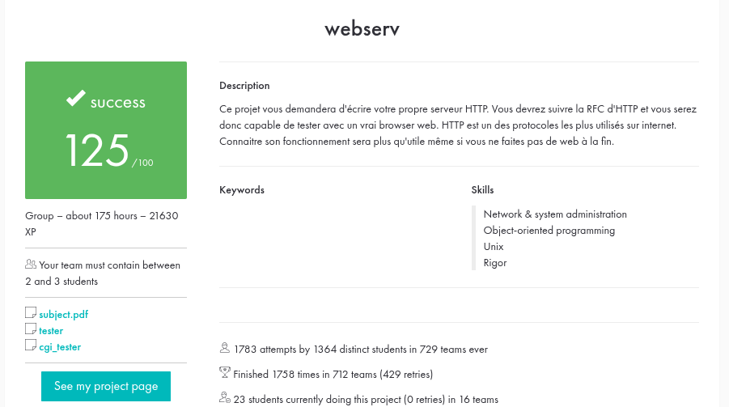

<h1 align="center">🌐 webserv</h1>

<p align="center">
  
  
  
  
  
</p>

<p align="center">
A non-blocking HTTP/1.0 web server written from scratch in C++98, in the spirit of NGINX.<br>
One thread, one <code>poll()</code> loop, many clients — with asynchronous CGI, virtual hosts and uploads.
</p>

Built as part of the 42 curriculum, **in a team of two**.

**Score: 125/100** ✅

<p align="center">
  
</p>

## 📖 Table of contents

- [About](#-about)
- [Features](#-features)
- [Build](#-build)
- [Usage](#-usage)
- [Configuration](#-configuration)
- [Project structure](#-project-structure)
- [How it works](#-how-it-works)
- [Skills demonstrated](#-skills-demonstrated)
- [Resources](#-resources)
- [Authors](#-authors)

## 🎯 About

`webserv` is an HTTP server that serves static websites, handles file uploads and deletions,
runs CGI scripts (Python, PHP, shell, compiled binaries) and supports name-based virtual hosts.

Everything is driven by a **single `poll()`-based reactor** that multiplexes every listening
socket, every client connection and every CGI pipe. No file descriptor is ever read or written
in a blocking call, so a slow client or a slow script never freezes the others.

The server is configured with an **NGINX-inspired configuration file**: declare one or more
`server` blocks, each binding a `host:port` and defining per-route rules. A single process can
listen on several ports and route requests to the right virtual host from the `Host` header.

The goal: understand how a web server really works — sockets, the HTTP protocol, non-blocking
I/O, process management (`fork` / `execve` / pipes) and resource ownership in C++98.

## ✨ Features

- **HTTP/1.0** with `GET`, `POST` and `DELETE` (per-route allow-lists, `405` otherwise)
- **Non-blocking I/O** on a single thread through one `poll()` reactor
- **Multiple servers and virtual hosts**, resolved by `host:port` and `server_name`
- **Static files** with a configurable `root`, default `index` and MIME-type detection
- **Directory listing** (`autoindex on`)
- **File upload and deletion**: `POST /uploads/<name>` stores the raw body in the location's `upload_dir` (`201` / `204`), `DELETE` removes it
- **Asynchronous CGI** (`.py`, `.php`, `.sh`, binaries…) with the full request environment,
  `PATH_INFO`, query string and chunked request bodies
- **Cookies**: `Set-Cookie` headers coming from CGI scripts are forwarded one per line
- **Redirections** (`return 301|302 <url>`)
- **Custom and generated error pages** (`error_page`)
- **Request body size limit** (`client_max_body_size`, answers `413`)
- **Timeouts** on idle connections and on CGI scripts (`504`), runaway children are killed
- **Clean shutdown** on `Ctrl-C`: no leaked memory, no leaked file descriptor (checked with Valgrind)

## 🛠 Build

Requirements: a C++98 compiler (`c++` / `g++` / `clang++`), `make`, a POSIX system (Linux / macOS).

```bash
git clone https://github.com/davsam97/webserv.git
cd webserv

make        # builds ./webserv
make clean  # removes object files
make fclean # removes object files and the binary
make re     # full rebuild
```

The project compiles with `c++ -Wall -Wextra -Werror -std=c++98`.

## 🚀 Usage

```bash
./webserv [configuration_file]
```

If no file is given, `configs/default.conf` is used. It serves the sample website in `www/`.

When the server is up you will see:

```
[12:25:44] Server Listening to: 127.0.0.1:8080, fd:3
```

Then open <http://127.0.0.1:8080/> in a browser, or try it from the terminal:

```bash
curl -i http://127.0.0.1:8080/                              # static page
curl -i http://127.0.0.1:8080/cgi-bin/python.py             # CGI
curl -i -X POST -d "hello" http://127.0.0.1:8080/cgi-bin/python.py
curl -i -H "Host: localhost2" http://127.0.0.1:8081/        # second virtual host
```

Stop the server with `Ctrl-C` (SIGINT).

## ⚙️ Configuration

Each `server { }` block describes one virtual host, and each `location { }` block overrides the
behaviour for a URL prefix.

```nginx
server {
    listen 127.0.0.1:8080;
    server_name localhost;

    root www/website;
    index index.html;
    client_max_body_size 10000;
    autoindex off;
    error_page 404 /errors/404.html;

    location / {
        methods GET;
    }

    location /cgi-bin/ {
        methods GET POST;
        cgi .py;            # run *.py through the matching interpreter
        cgi .sh;
        cgi .php php;       # optional explicit interpreter
    }

    location /uploads {
        methods GET POST DELETE;
        upload_dir www/website/uploads;
        autoindex on;
    }

    location /google {
        methods GET;
        return 302 https://www.google.com/;
    }
}
```

| Directive                  | Scope           | Description                                             |
|----------------------------|-----------------|---------------------------------------------------------|
| `listen <host:port>`       | server          | Address and port to bind.                               |
| `server_name`              | server          | Virtual host name(s) matched against the `Host` header. |
| `root`                     | server/location | Directory served for this scope.                        |
| `index`                    | server/location | Default file served for a directory.                    |
| `client_max_body_size`     | server/location | Max request body in bytes (else `413`).                 |
| `error_page <code> <path>` | server          | Custom error page for a status code.                    |
| `autoindex on\|off`        | server/location | Enable/disable directory listing.                       |
| `methods`                  | location        | Allowed HTTP methods (`GET POST DELETE`).               |
| `upload_dir`               | location        | Destination directory for uploaded files.               |
| `cgi <ext> [interpreter]`  | location        | Run files with `<ext>` as CGI (optional interpreter).   |
| `return <code> <url>`      | location        | Issue a redirect.                                       |

See [`configs/default.conf`](configs/default.conf) for a complete example.

## 🗂 Project structure

```
webserv/
├── Makefile
├── srcs/
│   ├── main.cpp        # entry point: parse config, build servers, run the loop
│   ├── config/         # configuration file parser (Config)
│   ├── event/          # poll() event loop (Reactor, AEventHandler)
│   ├── signal/         # SIGINT / SIGTERM shutdown, SIGPIPE ignored
│   ├── server/         # listening sockets (Server)
│   ├── connection/     # client connections and I/O buffers (Connection)
│   ├── request/        # HTTP request parsing (RequestParser)
│   ├── response/       # HTTP response building, static files, uploads (ResponseBuilder)
│   ├── cgi/            # asynchronous CGI execution (CgiHandler, CgiProcess)
│   ├── log/            # colored logging (Log)
│   └── utils/          # string / file / network helpers
├── configs/            # example configuration files
├── www/                # sample websites, CGI scripts, error pages
└── assets/             # images used by this README
```

## 🧠 How it works

### Reactor

Every file descriptor the program cares about (listening sockets, client connections and CGI
pipes) is registered with the reactor as an *event handler*. An *event* is simply a file descriptor
becoming readable or writable: the reactor wakes up, dispatches it to the handler that owns the
fd, and goes back to sleep. One thread therefore serves many simultaneous clients.

- **Centralised ownership.** The `Reactor` is the sole owner of the handlers it is given.
  Handlers flag themselves `finished`; the loop reaps them in a dedicated pass, closing their
  descriptors and deleting them once their last fd is gone. This deferred deletion avoids
  use-after-free while events are being dispatched.
- **CGI as an async handler.** A CGI request spawns a child with `fork` / `execve`, registers its
  two pipe ends in the loop and idles the client socket until the script finishes, so a slow
  script never blocks other clients. A timeout kills runaway children.

### Request lifecycle

```
accept() ─▶ Connection ─▶ RequestParser ─▶ virtual host + location lookup
                                                    │
                    ┌───────────────────────────────┼──────────────────────┐
                    ▼                               ▼                      ▼
              static file / autoindex        upload / delete         CGI (async)
                    └───────────────────────────────┬──────────────────────┘
                                                    ▼
                                            ResponseBuilder ─▶ send()
```

## 💡 Skills demonstrated

- Network programming with the BSD socket API (`socket`, `bind`, `listen`, `accept`, `poll`)
- Implementing a protocol from its RFC (HTTP/1.0, CGI/1.1), including chunked bodies
- Event-driven, non-blocking architecture in a single thread
- Process management: `fork`, `execve`, `pipe`, `waitpid`, signals
- Writing a configuration-file parser (tokenizer and validation)
- Ownership and lifetime management in C++98 (no leaks, no dangling handlers)
- Teamwork with Git on a shared codebase

## 📚 Resources

Classic references used while building this project:

- **RFC 1945** — *Hypertext Transfer Protocol — HTTP/1.0*: <https://datatracker.ietf.org/doc/html/rfc1945>
  ([FR](http://abcdrfc.free.fr/rfc-vf/rfc1945.html))
- **RFC 3875** — *The Common Gateway Interface (CGI) Version 1.1*: <https://datatracker.ietf.org/doc/html/rfc3875>
  ([FR](https://fr-academic.com/dic.nsf/frwiki/399061))
- **Beej's Guide to Network Programming** — <https://beej.us/guide/bgnet/>
- Linux man pages: `socket(2)`, `bind(2)`, `listen(2)`, `accept(2)`, `poll(2)`, `fcntl(2)`,
  `recv(2)`, `send(2)`, `fork(2)`, `execve(2)`, `pipe(2)`, `waitpid(2)`
- **NGINX documentation** (configuration syntax and semantics) — <https://nginx.org/en/docs/>
- **MDN Web Docs — HTTP** — <https://developer.mozilla.org/en-US/docs/Web/HTTP>
- **Wikipedia** — <https://en.wikipedia.org/wiki/List_of_HTTP_status_codes>
- **IBM** — [How sockets work](https://www.ibm.com/docs/en/i/7.4.0?topic=programming-how-sockets-work),
  [Non-blocking I/O with select](https://www.ibm.com/docs/en/i/7.2.0?topic=designs-example-nonblocking-io-select)
  (written for IBM i, but the concepts carry over)
- [99% of Developers Don't Get Sockets (YouTube)](https://www.youtube.com/watch?v=D26sUZ6DHNQ)

### Use of AI

AI assistance was used as a support tool, not as a replacement for our own implementation.
Concretely, it helped with:

- **Documentation**: drafting and structuring this `README.md`.
- **Explanations**: clarifying socket lifecycle states, the semantics of `poll()` flags
  (`POLLIN` / `POLLOUT` / `POLLHUP` / `POLLERR`), and CGI environment conventions.
- **Debugging**: handling edge cases in the reactor, such as treating `POLLHUP` as readable and
  handling a client disconnecting mid-CGI.
- **Code review**: sanity-checking C++98 compliance and resource ownership (which object
  owns/frees each fd and handler).

All architectural decisions, the configuration parser, the reactor, and the HTTP/CGI logic were
designed, written, and validated by us.

## 👤 Authors

- **David Samuel** ([davsam97](https://github.com/davsam97)) — 42 login: `dasamuel`
- **William Wu** — 42 login: `wiwu`
